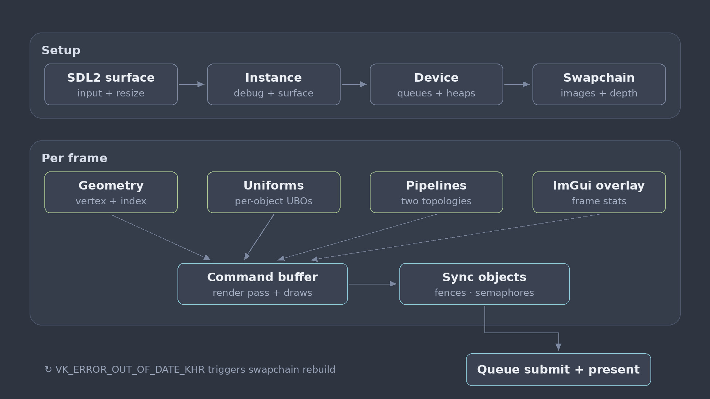
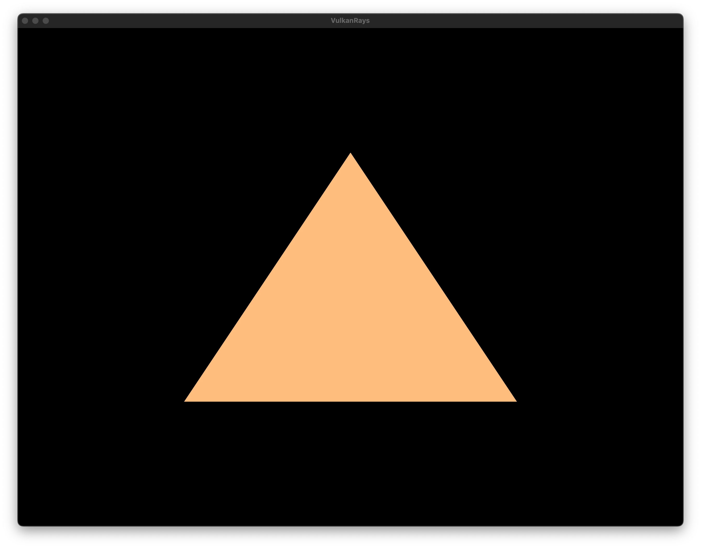
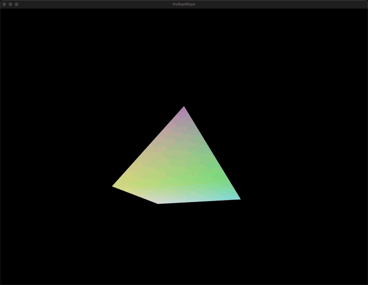
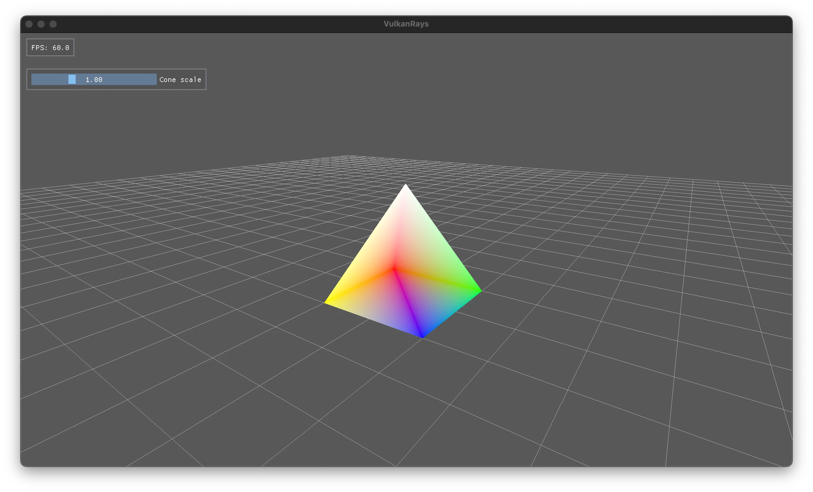
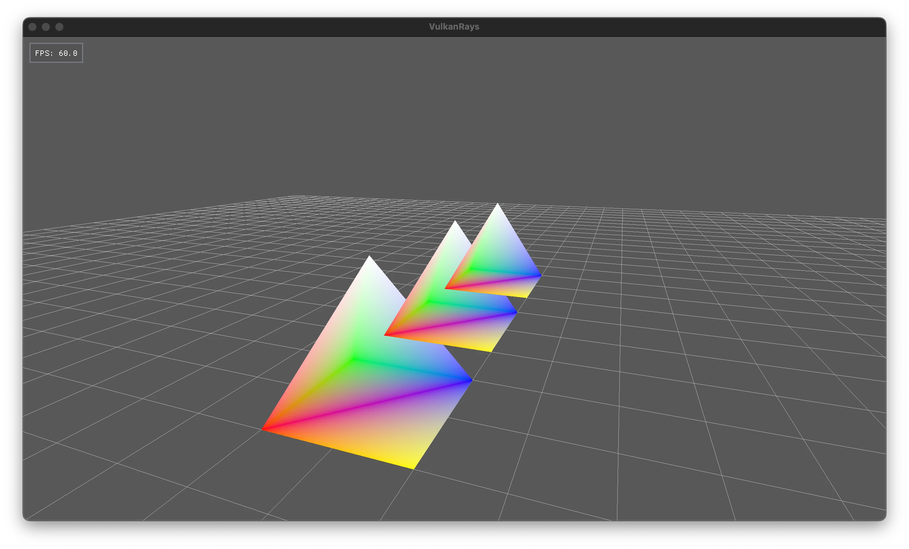
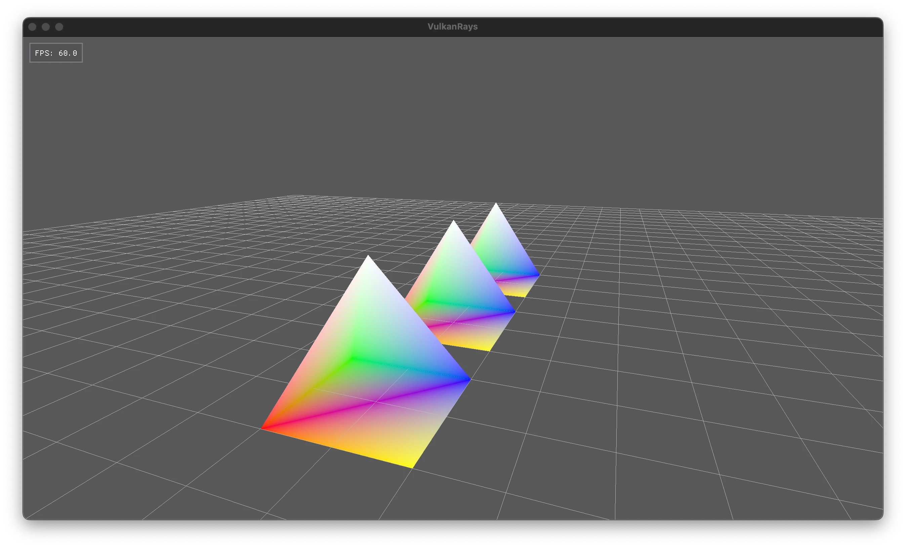

# VulkanRays

A small real-time renderer I built in C++17 to learn Vulkan, with no engine underneath.


*Three pyramids on a line grid. There's no lighting: each face blends the colours of its corners across the triangle, and the counter in the corner is the Dear ImGui overlay drawn on top of the scene.*

SDL2 opens the window and reads input, Dear ImGui draws an FPS overlay, and everything between my code and the GPU is Vulkan itself, with no engine or helper library in the middle. The scene is a line grid and three pyramids, and you move through it with WASD and mouse look.

Despite the name, it's a rasterizer, not a ray tracer. [need: whether ray tracing was ever the plan behind the name, in one line, or delete this marker]

## How it works



*The top row runs once at startup. The bottom row runs every frame, and an out-of-date swapchain sends the app back to rebuild it.*

- Everything in the scene is a `RenderObject`. Each one has a transform, creates its own vertex and index buffers, owns a uniform buffer for its matrix and a descriptor set that points at it, and records its own draw.
- The matrix math (`perspective`, `lookAt`, the axis rotations and `mat4_mul`) is my own code rather than a library. Every frame the app rebuilds each object's model-view-projection matrix and copies it into that object's uniform buffer.
- Primitive topology is part of a pipeline's state, so the grid (a line list) and the pyramids (triangles) need two graphics pipelines. Both run inside the same render pass, and the recording loop binds whichever one matches the object it's drawing.
- The render pass has a colour attachment and a depth attachment, and both pipelines depth-test.
- Up to three frames are in flight (`MAX_FRAMES_IN_FLIGHT = 3`). Each frame slot has its own fence and its own pair of semaphores, so the CPU only waits on the slot it's about to reuse. Command buffers are allocated one per swapchain image.
- Resizing the window, or getting `VK_ERROR_OUT_OF_DATE_KHR` back from acquire or present, waits for the device to go idle and rebuilds the swapchain along with the depth image, framebuffers and pipelines that depend on its size.
- Shading is unlit vertex colour. There's one vertex shader and one fragment shader, 18 lines of GLSL between them, and their SPIR-V is compiled into the binary as byte arrays.
- The validation layer is always on. If `VK_LAYER_KHRONOS_validation` isn't installed, the app won't start.

All of that is about 1,900 lines of C++ across 20 files, not counting Dear ImGui.

## How it got here

It started as a single file that follows the setup order of the Khronos Vulkan Tutorial.



*The first thing it drew. That one triangle took a 638-line file, because the instance, device, swapchain, render pass, pipeline, framebuffers and command buffers all have to exist before anything shows up.*



*The first 3D step needed vertex and index buffers, a uniform buffer, and the matrix functions. The rotation matrix is rebuilt and uploaded every frame.*



*For a while the overlay had a Cone scale slider that rebuilt the pyramid's vertex buffer as you dragged it. I took it out to restructure rendering around a list of objects instead of one adjustable pyramid.*

## Two things that broke

### Splitting the file

Everything lived in one file until it reached 977 lines, and then I split it into seven classes. That broke things in a way that's specific to Vulkan's explicit lifetimes. In the single file the handles were globals. Once they lived inside C++ objects, when a buffer got freed depended on which object owned it and when that object went away, and the app started crashing with access violations. I gave `VulkanBuffer` an explicit `destroy()` that frees its memory and nulls its handles, so tearing a buffer down twice does nothing.

### Depth, and a blank screen

With three pyramids and no depth buffer, whichever pyramid was drawn last ended up in front, however far away it was. Adding depth meant a depth image and its memory, a second attachment on the render pass, depth testing in the pipeline, and a second clear value every frame.

<p>
  
  
</p>

*Same camera, same three pyramids. Without a depth buffer, draw order decides which one is in front. With depth testing, the nearest one hides the others.*

The first build with depth drew an empty scene. A blank frame says almost nothing on its own, but the validation layer named a specific mismatch: the render pass had two attachments, and the command buffer began it with one clear value. That pointed at command recording rather than the depth setup. The main loop recorded the frame correctly, then reset the same command buffer and recorded an older version of the pass over it, left over from before depth, with a single clear value. Only that second recording was submitted, so the depth attachment was never cleared. Deleting the duplicate brought the scene back.

## Build and run

You need:

- The [Vulkan SDK](https://vulkan.lunarg.com/sdk/home), with `VULKAN_SDK` set to its install path. CMake stops if it isn't set. The SDK also provides the validation layer the app requires.
- SDL2. On Windows, CMake expects SDL2's headers and libraries inside the Vulkan SDK (`%VULKAN_SDK%\Include\SDL2` and `%VULKAN_SDK%\Lib\SDL2.lib`).
- CMake 3.8 or newer, Ninja, and a C++17 compiler.

Dear ImGui is already in `imgui/`, along with its SDL2 and Vulkan backends.

On Windows, from a Visual Studio developer prompt (the presets use `cl.exe`):

```
cmake --preset x64-release
cmake --build out/build/x64-release
out\build\x64-release\VulkanRays.exe
```

`x64-debug` works the same way.

On other platforms, `CMakeLists.txt` falls back to `find_library` for Vulkan and SDL2, but its include paths still assume the Windows SDK layout (`$VULKAN_SDK/Include/SDL2`), so you may need to point them at your SDL2 headers first. After that it's a normal CMake build:

```
cmake -S . -B build -G Ninja -DCMAKE_BUILD_TYPE=Release
cmake --build build
./build/VulkanRays
```

### Shaders

The GLSL lives in `VulkanRays/shaders/`. The compiled SPIR-V is checked in, both as `.spv` files and as the `.inc` byte arrays that `VulkanPipeline.cpp` includes, so you only need this step if you change a shader. Run `build_shaders.bat` from inside `VulkanRays/shaders`: it compiles both shaders with `glslangValidator` (part of the Vulkan SDK) and regenerates the `.inc` files with `xxd -i`, so both need to be on your `PATH`. Then rebuild.

## Controls

| Input | Action |
| --- | --- |
| W / S | Move forward and back along the view direction |
| A / D | Strafe left and right |
| Left click | Capture the mouse for mouse look |
| Esc | Release the mouse |

Close the window to quit. Esc only releases the mouse.

## Code layout

```
VulkanRays/
  VulkanRays.cpp      main(): creates the VulkanApp and runs it
  VulkanApp.*         window, main loop, input, render pass, command recording, ImGui, swapchain rebuild
  VulkanInstance.*    instance, validation layer, debug messenger, surface
  VulkanDevice.*      physical device choice, logical device, queues, memory type lookup
  VulkanSwapchain.*   swapchain and image views
  VulkanPipeline.*    shader modules and the two pipelines (triangles, lines)
  VulkanBuffer.*      buffers and their memory, uploads, destroy()
  RenderObject.*      RenderObject base class, PyramidObject, GridObject
  CoreRendering.*     depth resources, sync objects, descriptor pools, swapchain helpers
  MathUtils.*         Mat4, perspective, lookAt, rotations, mat4_mul
  shaders/            triangle.vert and triangle.frag, compiled .spv and .inc, build_shaders.bat
imgui/                Dear ImGui 1.92.1 with the SDL2 and Vulkan backends
```

## Known limits

- There are no textures and no lighting. Every surface is interpolated vertex colour.
- `perspective()` is written in OpenGL's form, but Vulkan's clip space has Y pointing down and depth running from 0 to 1 instead of -1 to 1. Right now the vertex data compensates instead of the matrix: the pyramid's tip sits at y = -1 so it renders pointing up, and mouse pitch adds the mouse's vertical motion without negating it. That puts a property of the projection into the model data, which is the wrong place for it. Next I'd move the Y flip and the 0 to 1 depth range into `perspective()` so the pyramid and the mouse pitch can go back to their natural signs.

## Credits

The setup follows the order of the [Khronos Vulkan Tutorial](https://docs.vulkan.org/tutorial/latest/00_Introduction.html), and [Sascha Willems' Vulkan samples](https://github.com/SaschaWillems/Vulkan) were the other reference. [Dear ImGui](https://github.com/ocornut/imgui) draws the overlay.
