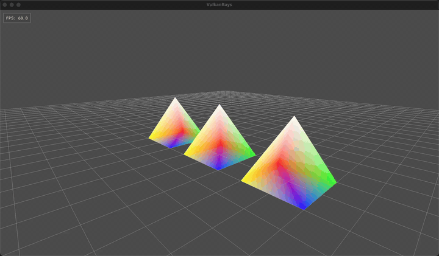

# VulkanRays

A small C++17 Vulkan renderer with SDL2 and Dear ImGui.



*Three pyramids on a line grid, with the Dear ImGui FPS overlay in the corner.*

## Features

- Matrix math (`perspective`, `lookAt`, axis rotations, `mat4_mul`) written by hand in `MathUtils`, with no math library. Each object's model-view-projection matrix is rebuilt every frame and copied into its own uniform buffer.
- Scene objects are `RenderObject`s. Each one owns its vertex and index buffers, its uniform buffer and descriptor set, and records its own draw.
- Two graphics pipelines in one render pass: triangles for the pyramids and a line list for the grid.
- Depth testing, with a depth attachment on the render pass.
- Up to three frames in flight (`MAX_FRAMES_IN_FLIGHT = 3`), each with its own fence and pair of semaphores.
- Swapchain rebuild on window resize or `VK_ERROR_OUT_OF_DATE_KHR`, including the depth image, framebuffers and pipelines.
- Dear ImGui FPS overlay drawn on top of the scene.
- SPIR-V for both shaders embedded in the binary as byte arrays.
- Validation layer always enabled. The app won't start if `VK_LAYER_KHRONOS_validation` isn't installed.

## Requirements

- The [Vulkan SDK](https://vulkan.lunarg.com/sdk/home), with `VULKAN_SDK` set to its install path. CMake stops if it isn't set. The SDK also provides the validation layer.
- SDL2. On Windows, CMake expects SDL2's headers and libraries inside the Vulkan SDK (`%VULKAN_SDK%\Include\SDL2` and `%VULKAN_SDK%\Lib\SDL2.lib`).
- CMake 3.8 or newer, Ninja, and a C++17 compiler.

Dear ImGui is included in `imgui/` along with its SDL2 and Vulkan backends.

## Build and run

### Windows

From a Visual Studio developer prompt (the presets use `cl.exe`):

```
cmake --preset x64-release
cmake --build out/build/x64-release
out\build\x64-release\VulkanRays.exe
```

Use `x64-debug` for a debug build.

### Other platforms

`CMakeLists.txt` falls back to `find_library` for Vulkan and SDL2, but its include paths assume the Windows SDK layout (`$VULKAN_SDK/Include/SDL2`), so you may need to point them at your SDL2 headers first. Then:

```
cmake -S . -B build -G Ninja -DCMAKE_BUILD_TYPE=Release
cmake --build build
./build/VulkanRays
```

### Shaders

The GLSL is in `VulkanRays/shaders/`. The compiled SPIR-V is checked in, both as `.spv` files and as the `.inc` byte arrays that `VulkanPipeline.cpp` includes, so this step is only needed after changing a shader.

From `VulkanRays/shaders`, run `build_shaders.bat`. It compiles the shaders with `glslangValidator` (part of the Vulkan SDK) and regenerates the `.inc` files with `xxd -i`, so both need to be on your `PATH`. Then rebuild.

## Controls

| Input | Action |
| --- | --- |
| W / S | Move forward and back along the view direction |
| A / D | Strafe left and right |
| Left click | Capture the mouse for mouse look |
| Esc | Release the mouse |

Close the window to quit.

## Project layout

```
VulkanRays/
  VulkanRays.cpp      main(): creates the VulkanApp and runs it
  VulkanApp.*         window, main loop, input, render pass, command recording, ImGui, swapchain rebuild
  VulkanInstance.*    instance, validation layer, debug messenger, surface
  VulkanDevice.*      physical device choice, logical device, queues, memory type lookup
  VulkanSwapchain.*   swapchain and image views
  VulkanPipeline.*    shader modules and the two pipelines (triangles, lines)
  VulkanBuffer.*      buffers and their memory, uploads, destroy()
  RenderObject.*      RenderObject base class, PyramidObject, GridObject
  CoreRendering.*     depth resources, sync objects, descriptor pools, swapchain helpers
  MathUtils.*         Mat4, perspective, lookAt, rotations, mat4_mul
  shaders/            triangle.vert and triangle.frag, compiled .spv and .inc, build_shaders.bat
imgui/                Dear ImGui 1.92.1 with the SDL2 and Vulkan backends
```

## Known limitations

- No textures or lighting. Every surface is interpolated vertex color.
- `perspective()` uses OpenGL's clip-space conventions (Y up, depth from -1 to 1) rather than Vulkan's (Y down, depth from 0 to 1). The pyramid's vertex data and the mouse pitch are flipped to compensate.

## Credits

- [Khronos Vulkan Tutorial](https://docs.vulkan.org/tutorial/latest/00_Introduction.html), which the setup order follows.
- [SDL2](https://www.libsdl.org/) for the window and input.
- [Dear ImGui](https://github.com/ocornut/imgui) for the overlay.
